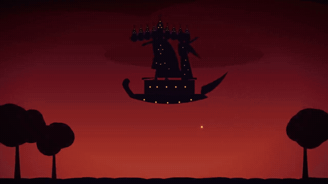
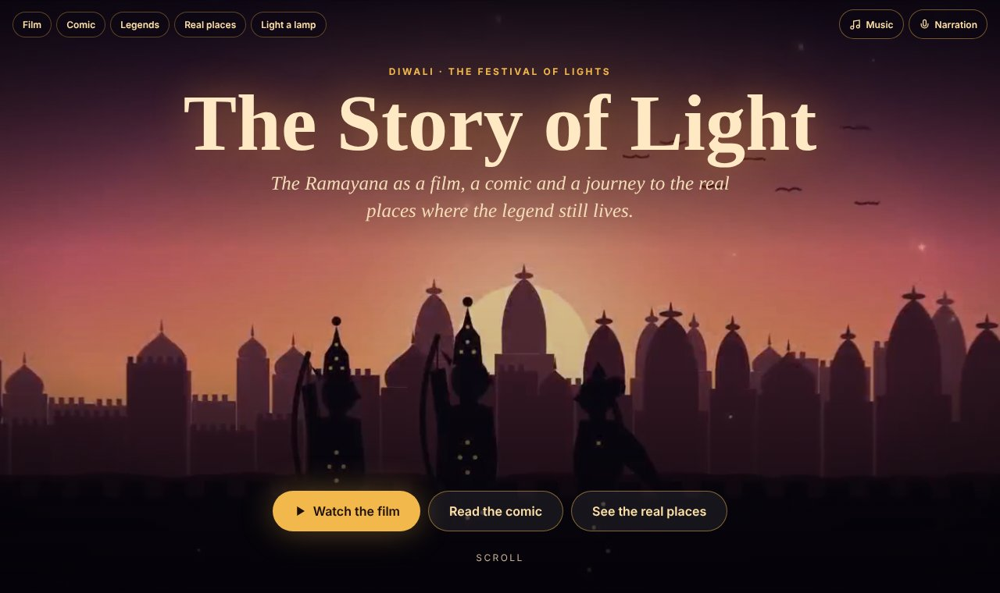
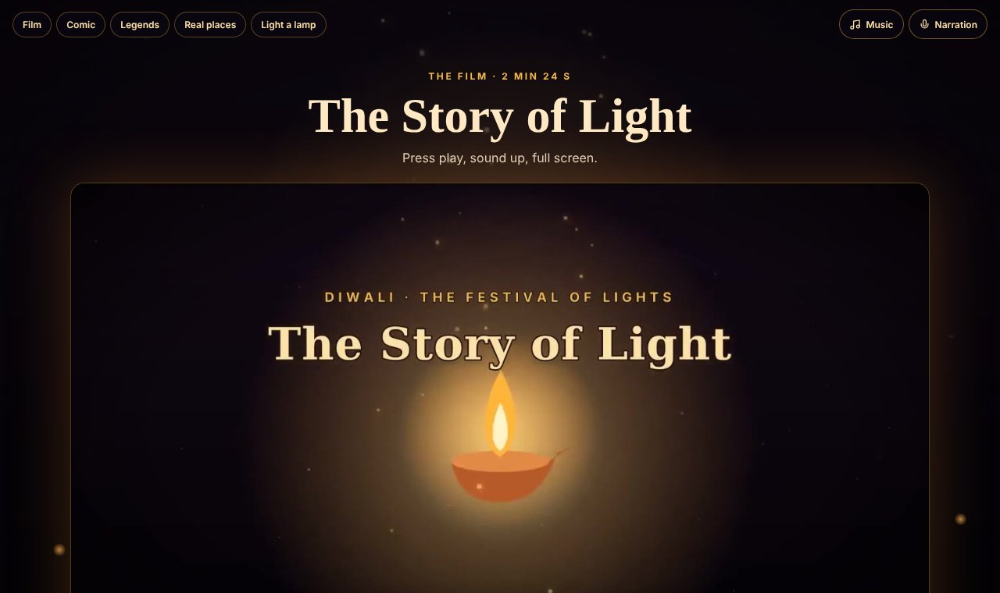
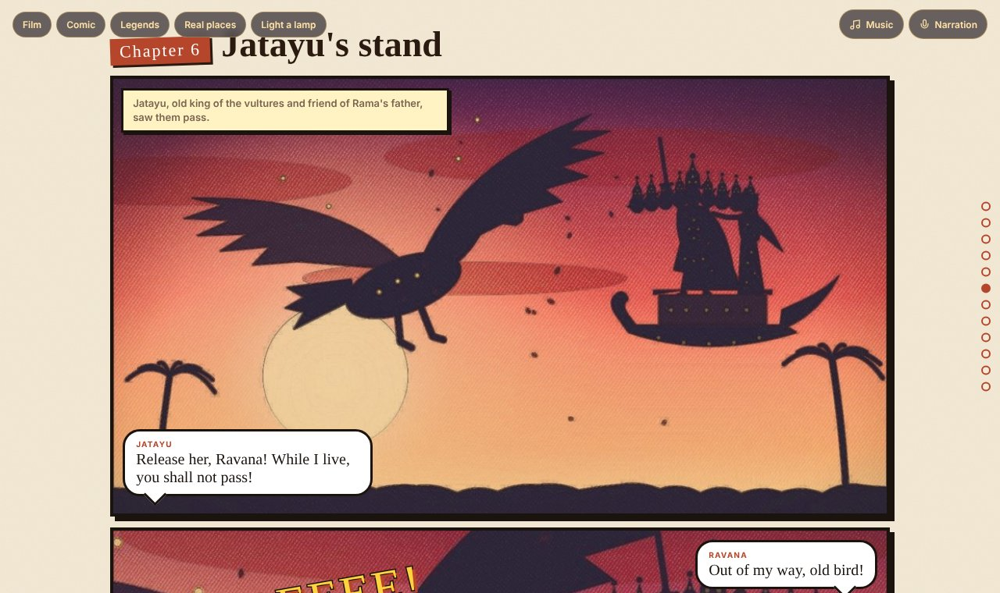
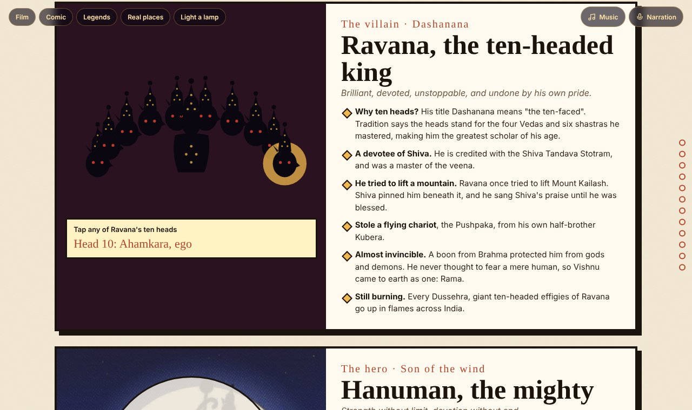
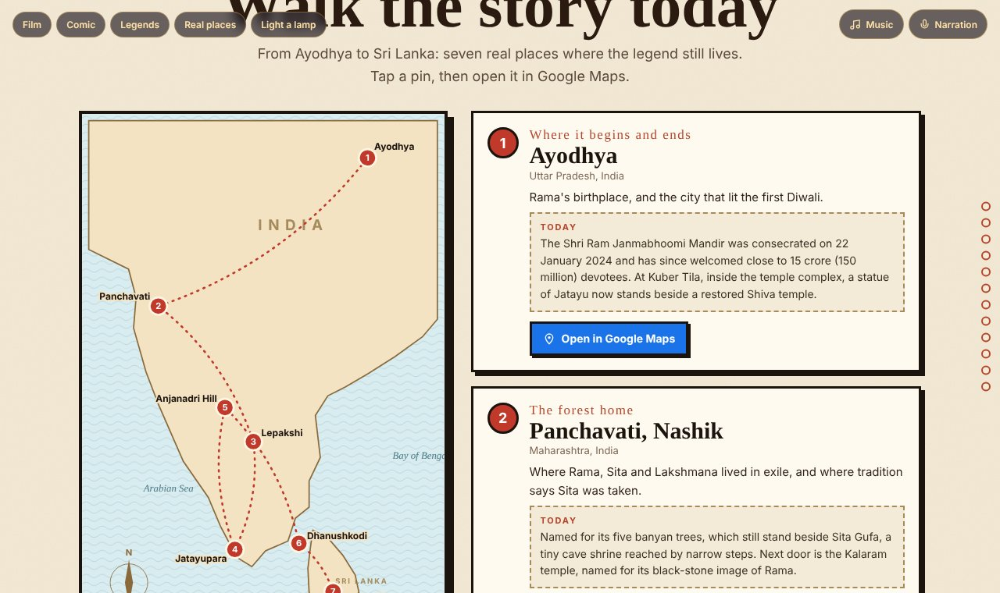
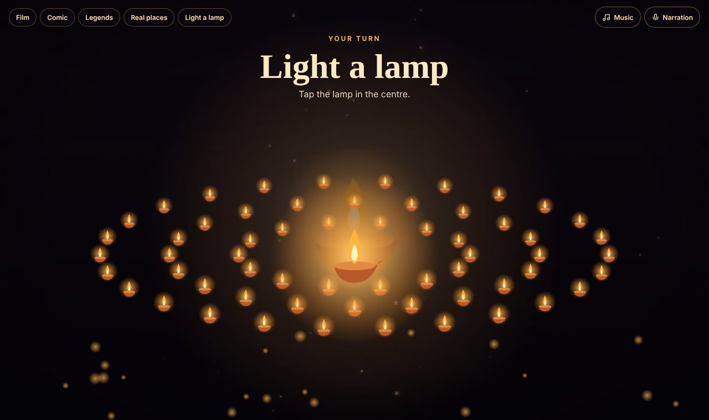
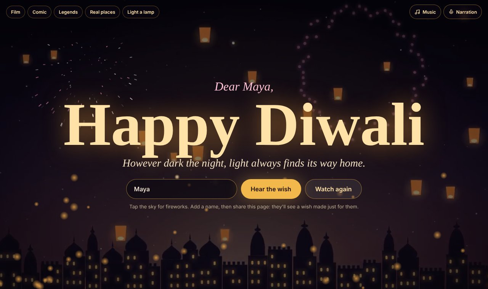

  

<h1 align="center">The Story of Light</h1>

<i>Diwali, the Ramayana, and the real places where the legend still lives.</i>

  <a href="https://rroopha-25.github.io/story-of-light/"><b>▶ Visit the website</b></a> ·
  <a href="https://rroopha-25.github.io/story-of-light/privacy.html">Privacy policy</a>

---

## What is it?

Every autumn, more than a billion people light a lamp for Diwali, the festival of lights. **The Story of Light** is a free website that tells everyone, anywhere, *why*. It retells the Ramayana through a short film, a comic, interactive character cards and a map of real places you can visit today.

No sign-up and no ads. It works on phones and computers.

---

## 🎬 1. Opens with a film

The page opens on a moving trailer. Tap **Watch the film** for a 2½-minute animated short in a shadow-puppet style, with its own Indian-inspired score and subtitles.

---

## 📖 2. A graphic novel in coloured pencil

Twelve chapters drawn in a hand-coloured pencil style, with comic panels, caption boxes, speech bubbles and sound effects. Panels pop in as you scroll. A red pin on a chapter takes you to the real place where it is said to have happened.

---

## ⚡ 3. Legend files: tap and play

Meet the mighty ones up close.

- **Ravana:** tap each of his **ten heads** to reveal what it stands for, and learn why he was so powerful.
- **Hanuman:** press **Grow!** and **Shrink!** to change his size, as he did against the sea monster Surasa. Read about the leap across the ocean and the mountain he carried.
- **Jatayu:** the old king of the vultures who gave everything to protect Sita.

---

## 🗺️ 4. Walk the story today

A map of **seven real places** in India and Sri Lanka, each with what it is today and a one-tap **Open in Google Maps** button:

| # | Place | Story moment |
|---|---|---|
| 1 | Ayodhya, Uttar Pradesh | Where it begins and ends |
| 2 | Panchavati, Nashik, Maharashtra | The forest home, where Sita was taken |
| 3 | Lepakshi, Andhra Pradesh | "Le Pakshi!": Rise, bird |
| 4 | Jatayupara, Chadayamangalam, Kerala | Where Jatayu fell: the world's largest bird sculpture |
| 5 | Anjanadri Hill, Hampi, Karnataka | Hanuman's kingdom |
| 6 | Dhanushkodi, Rameswaram, Tamil Nadu | Where the bridge to Lanka began |
| 7 | Seetha Eliya, Nuwara Eliya, Sri Lanka | Ashok Vatika, where Sita waited |

---

## 🪔 5. Light a lamp, send a wish

Tap the centre lamp and watch rings of diyas light up. Then type someone's name: the page becomes a personal **Happy Diwali** wish, with fireworks you launch by tapping the sky. Share the link and they'll see a wish made just for them.

---

## 📱 Made for phones too

---

## 🔒 Privacy

No accounts, no cookies, no analytics, no ads. A name typed into the wish stays in the visitor's browser and the shared link only. Read the full [privacy policy](https://rroopha-25.github.io/story-of-light/privacy.html).

## A note on the places

Places are described as local tradition holds them. Some, like the spot where Jatayu fell or Hanuman's birthplace, are claimed by more than one region.

🪔 <b>Happy Diwali</b> 🪔

