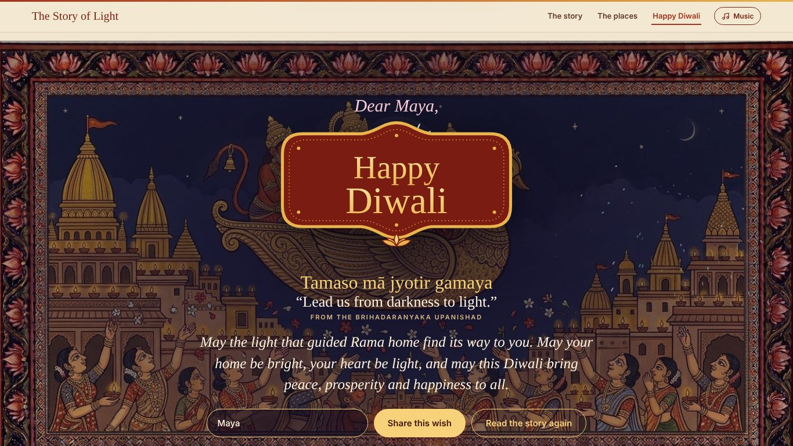
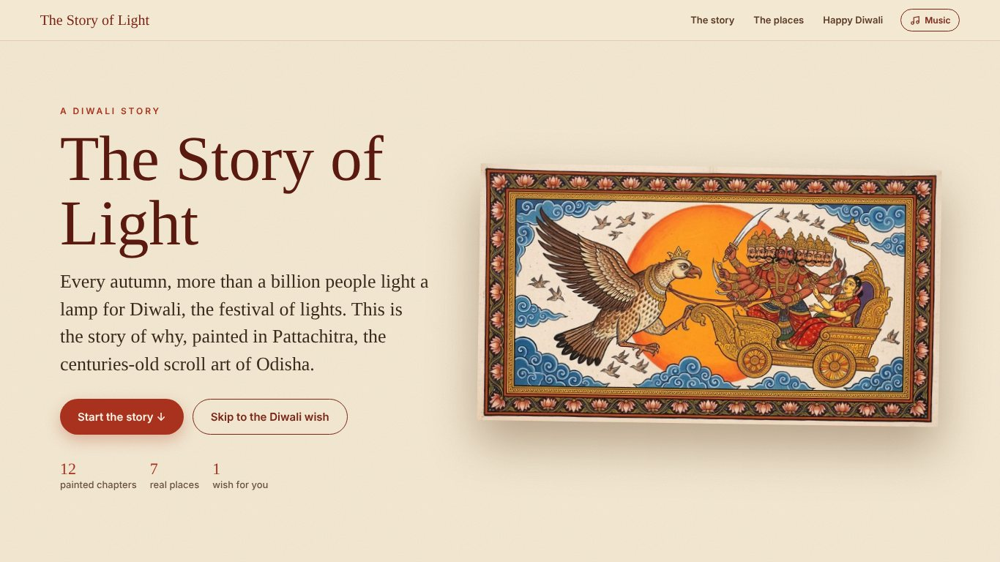
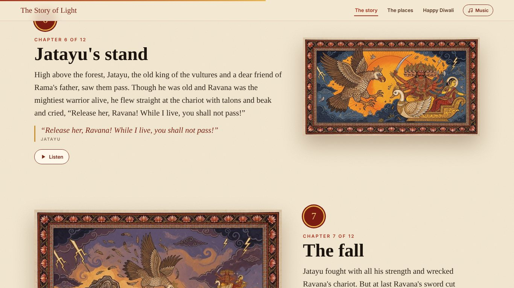
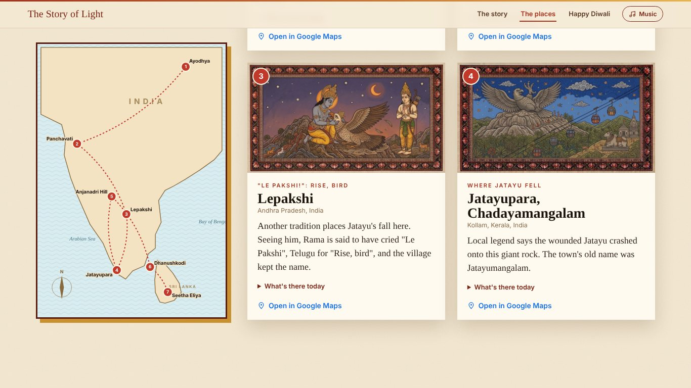
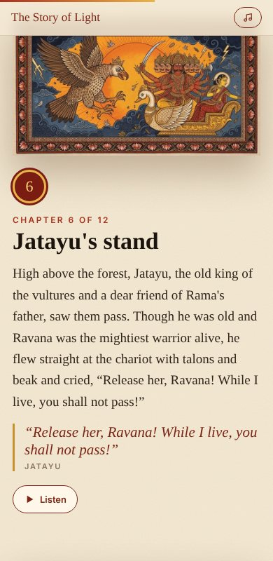

<h1 align="center">The Story of Light</h1>

<i>The story of Diwali in Odisha Pattachitra paintings, the real places where it lives today, and a Happy Diwali wish for everyone.</i>

<a href="https://rroopha-25.github.io/story-of-light/"><b>&#9654; Visit the website</b></a> &middot; <a href="https://rroopha-25.github.io/story-of-light/privacy.html">Privacy policy</a>

---

Every autumn, more than a billion people light a lamp for **Diwali**, the festival of lights. This website tells the world **why**, in one simple scroll with three parts.

## 📖 Part one: The Story

Twelve chapters of the Ramayana, each a hand-painted **Pattachitra** scene beside the story: Rama's exile, the golden deer, the brave vulture king **Jatayu**, Hanuman's leap, the bridge to Lanka, the battle of light against darkness, and the first Diwali. Every chapter has a **Listen** button.

## 🗺️ Part two: Where the story lives today

A map and seven real places in India and Sri Lanka, each painted as it looks today, with what you'll find there and a **Google Maps** link.

| # | Place | Story moment |
|---|---|---|
| 1 | Ayodhya, Uttar Pradesh | Where it begins and ends |
| 2 | Panchavati, Nashik, Maharashtra | The forest home, where Sita was taken |
| 3 | Lepakshi, Andhra Pradesh | "Le Pakshi!": Rise, bird |
| 4 | Jatayupara, Chadayamangalam, Kerala | Where Jatayu fell: the world's largest bird sculpture |
| 5 | Anjanadri Hill, Hampi, Karnataka | Hanuman's kingdom |
| 6 | Dhanushkodi, Rameswaram, Tamil Nadu | Where the bridge to Lanka began |
| 7 | Seetha Eliya, Nuwara Eliya, Sri Lanka | Ashok Vatika, where Sita waited |

## 🪔 Part three: Happy Diwali

Lanterns rise, fireworks burst, and a Pattachitra-style banner unfolds with a wish for everyone:

> *Tamaso mā jyotir gamaya*: "Lead us from darkness to light." (Brihadaranyaka Upanishad)

Add a name and tap **Share this wish**: the recipient opens straight to a wish made for them.

## 📱 Made for phones

## 🔒 Privacy

No accounts, no cookies, no tracking. See the [privacy policy](https://rroopha-25.github.io/story-of-light/privacy.html). Places are described as local tradition holds them; some are claimed by more than one region.
